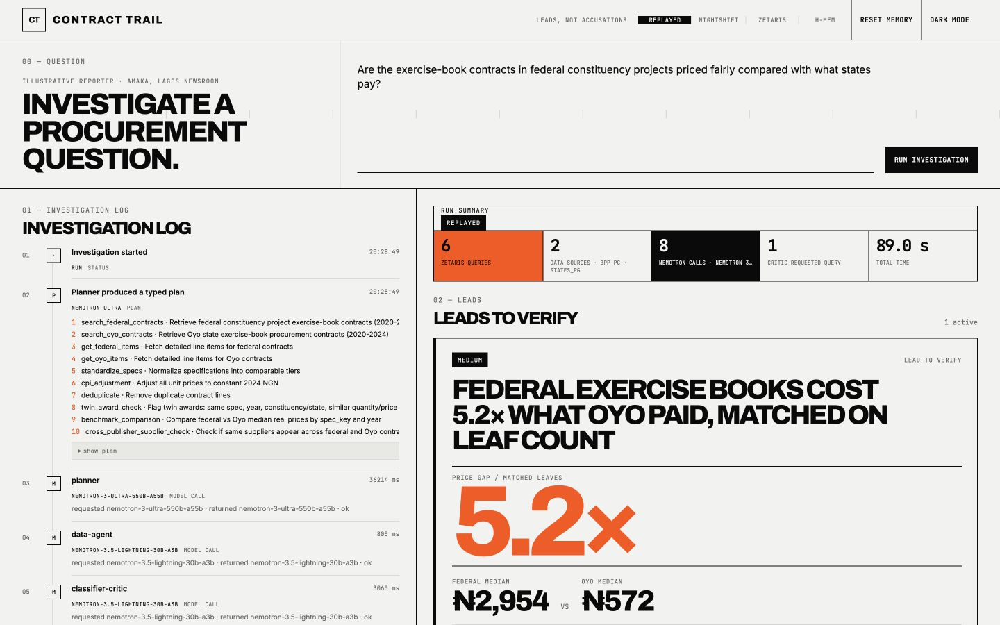

# Contract Trail

**Investigative journalists get a short list of cited, pre-challenged procurement leads in about a minute, instead of days of cross-referencing spreadsheets from different government portals.**

> **Leads, not accusations.** Contract Trail surfaces patterns in public procurement records that deserve a closer look. Every lead is something to verify, never a finding of wrongdoing.



Built for the **Open Agent Hackathon 2026** · Track 02, *The Agent That Can Explain Why* · Data: **Zetaris** · Memory: **Meterless H-MEM** · Models: **NVIDIA Nemotron via Meterless Nightshift**.

---

## The problem

Governments publish procurement data under the Open Contracting Data Standard (OCDS), but each publisher posts separately, in its own shape, with duplicates and messy text. In Nigeria alone the [Open Contracting Data Registry](https://data.open-contracting.org/en/search/?q=nigeria) lists 13 separate federal and state publications.

Reporters do this by hand. Dataphyte's exposé of inflated exercise-book contracts in Oyo State started with downloading "thousands of lines" from a state portal into spreadsheets and filtering for red flags ([GIJN](https://gijn.org/stories/notebookgate-how-nigerias-dataphyte-exposed-corruption-in-government-contracts/)). ICIR's editors say "access to data is a major challenge" ([ICIR](https://www.icirnigeria.org/poor-access-to-data-rots-in-private-sector-slowing-nigerias-fight-against-corruption-stakeholders/)).

## The case: Amaka asks one question

*Amaka is an illustrative reporter at a Lagos newsroom.* She asks:

> **"Are the exercise-book contracts in federal constituency projects priced fairly compared with what states pay?"**

1. **Planner** (Nemotron Ultra 550B) breaks the question into steps.
2. **Data agent** (Nemotron Lightning 30B) calls typed query tools. Every query runs **through Zetaris**, across two separate data sources: federal (`bpp_pg`) and state (`states_pg`).
3. **Deterministic rules** (plain, tested TypeScript, never the model) compute price per book, remove duplicate releases, exclude laptop "notebooks" and mixed contracts, and adjust prices to 2025 naira using the World Bank's Nigeria CPI series.
4. **Classifier critic** and **defence critic** (Lightning and Ultra) try to explain each lead away: inflation, different specifications, distribution costs, separate lots. The defence critic **requests an extra query**, a comparison matched on leaf count, and the lead is **re-scored**: *HIGH → MEDIUM, downgraded by defence critic.*
5. **Reporter** (Lightning) writes the lead cards, each with arithmetic, evidence IDs linked to the source records, the critic's challenge and the answer, and "what to verify on the ground".
6. Amaka **dismisses** a lead she has already checked. **H-MEM** stores her decision, and the next run shows that lead as *superseded by reporter decision* instead of raising it again.

### What it found (real data, labelled as leads)
- **Price gap:** on matched 60- and 80-leaf books, the federal books-only contracts (2023–24) cost a median **₦2,954 per book**, against **₦572** for Oyo State's purchases (2019–22). Both are in 2025 naira, a **5.2× gap**. The defence critic notes possible explanations (distribution to dispersed schools, smaller lots), and the lead tells the reporter what to check.
- **Twin awards:** two federal contracts signed the same day (2024-10-15), each for 8,200 books, valued ₦19,688,875 and ₦19,753,375 (a 0.33% difference).
- **Context:** 7 suppliers won awards both federally and in Osun State. This is shown as context, not as a flag.

## How the sponsor technology is used
See **[docs/SPONSORS.md](docs/SPONSORS.md)** for exact calls. In short:
- **Zetaris:** the only read path. Two JDBC data sources are registered with `CREATE DATASOURCE` / `REGISTER DATASOURCE TABLES` and queried with `POST /sql-editor/sqls/run`. One query joins `bpp_pg` and `states_pg` (federated).
- **Meterless Engine, H-MEM:** implemented in `src/engines/hmem/` from the upstream spec; **13/13 upstream conformance checks pass**; it powers the dismiss-and-supersede feature.
- **Meterless Nightshift:** the only model provider. It uses the OpenAI-compatible Runtime, with pinned model IDs, and the requested model, returned model and request ID are logged for every call.
- **NVIDIA Nemotron:** Ultra 550B plans and argues the defence; Lightning 30B handles tools, classification and reporting. 8 Nemotron calls per run.

## Dependencies
- Zetaris local Docker platform 2.4.3.
- Meterless Nightshift local runtime. Its version is not exposed by the configured endpoint or pinned in this repository.
- NVIDIA Nemotron 3 Ultra 550B (nvidia/nemotron-3-ultra-550b-a55b) and 3.5 Lightning 30B (nvidia/nemotron-3.5-lightning-30b-a3b).
- PostgreSQL 16 via the postgres:16-alpine Docker image.
- Node.js 24.15.0 in the verified development environment.
- Fastify 5.12.7, MIT.
- React 19.3.1, MIT. React DOM 19.3.1, MIT.
- Vite 7.3.7, MIT.
- Vitest 5.0.5, MIT.

## Pre-existing components
None of the application code existed before the event. It was built from 24-27
October 2026.

Built on:

- Zetaris.
- Meterless Nightshift.
- The Meterless H-MEM specification and conformance suite, Apache-2.0. The
  repository contains no vendored Meterless files. A local vendor/meterless/
  checkout is gitignored and used only for conformance.
- NVIDIA Nemotron.
- The Open Contracting Data Standard.

## Check it yourself
**No setup (replayed real run):**
```sh
git clone https://github.com/AjKadri/contract-trail.git && cd contract-trail
npm ci
SAMPLE_MODE=true npm run demo      # REPLAYED: real recorded Zetaris rows and Nemotron outputs, no services or keys
```
Expected: `[demo] REPLAYED … saved_rows=239 tool_calls=6 … lead=price-gap-federal-vs-oyo severity=medium`.

- **Run records:** [`runs/`](runs/) holds 6 curated real live sessions. Each includes the SQL text, row counts, timings, model IDs, critic challenges and disposition changes.
- **Verify any number:** every evidence ID links to its record on data.open-contracting.org, and every lead shows its arithmetic.

**Full live setup** (needs Zetaris, which requires registration, and Nightshift, on your machine): see [docs/SETUP.md](docs/SETUP.md).

## What is live, replayed or not built
| Part | Status |
|---|---|
| OCDS procurement data (BPP federal, Osun, Oyo) | **Live through Zetaris**, from dated registry snapshots (BPP retrieved Oct 2026) |
| Nigeria CPI | Through Zetaris, from a cited World Bank snapshot table (a live REST table was registered, but Zetaris could not parse the World Bank's array-shaped response) |
| Agent reasoning | **Live** Nemotron via Nightshift; **replayed** in `SAMPLE_MODE` |
| Amaka | Illustrative persona |
| Company-registry or ownership checks | **Not built**: no open API |

## What's next
More OCDS publishers (any of the 50+ countries that publish in the standard), company-registry checks where open data exists, and export of a lead pack for an editor.

## Data licences
- BPP federal, publication 64: ODC-PDDL. The Registry page's licence field points to the BPP licence URL at http://nocopo.bpp.gov.ng/license, but that page was unavailable during verification, so the exact licence text remains a caveat.
- Osun, publication 118: Open Data Commons Public Domain Dedication and Licence (PDDL).
- Oyo, publication 106: the Registry lists http://oyostate.gov.ng as the licence URL and flags licence URLs as placeholders in its data-quality notes. The applicable licence is unclear.
- World Bank, Nigeria CPI (`FP.CPI.TOTL`), CC BY 4.0.
- H-MEM spec and conformance suite: [Meterless](https://github.com/Meterless/Meterless), Apache-2.0.

## Licence
- Code: Apache-2.0. See [LICENSE](LICENSE).
- Data: OCDS data remains under its publishers' licences and is not covered by Apache-2.0.
